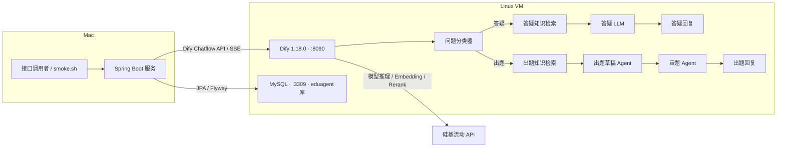

# eduagent 教育助教

## 项目简介

这是一个**基于 Dify 的 RAG + 多 Agent（分类路由、出题/审题双 Agent）教育助教应用，以及 Spring Boot 对 Dify API 的服务封装与评测**。

学科范围为初中物理·力学。学生可以询问概念、现象或简单计算，也可以请求生成练习题。分类器决定进入答疑或出题分支；出题分支先生成草稿，再交给审题 Agent 检查后回复。Spring Boot 提供统一的会话、流式输出、本地记录和批量评测接口。

Dify 工作流已冻结并导出为 [eduagent-assistant.yml](dify/eduagent-assistant.yml)，评测过程与结果见“评测”章节。本地模拟测试用于验证服务逻辑，不计入模型评测结果。

## 演示视频

下载原文件：[eduagent-demo.mp4](docs/demo/eduagent-demo.mp4)


https://github.com/user-attachments/assets/5cef60e0-af17-4651-b7c6-4cc764d58037


内容依次为：README 与架构图 → Dify 工作流（分类路由、出题/审题双 Agent）→ 通过 Spring Boot 流式接口演示答疑、出题、知识库外问题拒答、诱导编造拒绝 → 4 轮评测记录。终端演示使用 [scripts/demo.sh](scripts/demo.sh)，等待模型回复的片段做了加速处理。

## 架构图



## 技术栈与模型配置

服务使用 Java、Spring Boot、Maven、Spring MVC、WebClient、SseEmitter、Spring Data JPA 与 Flyway。JPA 负责实体读写和事务，Flyway 管理表结构；本地测试使用 JUnit、MockWebServer 和 H2 MySQL 模式。具体服务版本、环境变量和本机命令见 [服务文档](docs/service.md)。

| 环节 | 当前模型或方式 |
| --- | --- |
| 分类器 | Qwen3-8B |
| 答疑 | Qwen3-30B-A3B-Instruct-2507 |
| 出题草稿 | Qwen3-30B-A3B-Instruct-2507 |
| 审题 | Qwen2.5-72B-Instruct |
| Embedding | BAAI/bge-m3 |
| Rerank | bge-reranker-v2-m3 |
| 检索 | Hybrid Search |
| 模型供应商 | 硅基流动 API |

模型与检索配置依据 [人工评测记录的各轮配置](eval/manual-review.md)，冻结的模型节点也可在 DSL 中查看。检索命中不必然能支持答案；拒答时不会把命中文档作为用户引用展示。

## 目录结构

```text
eduagent/
├── README.md
├── .gitignore
├── dify/
│   └── eduagent-assistant.yml      # 冻结的 Chatflow DSL
├── kb/physics-mechanics/          # 力学讲义及范围说明
├── eval/
│   ├── questions.json            # 评测主文件
│   ├── questions.md              # 人工阅读版
│   ├── validate.py               # 评测文件校验
│   ├── manual-review.md          # 人工判定原始记录
│   └── reports/                  # 历史评测报告，保留为作品集证据
├── service/
│   ├── README.md
│   ├── .env.example              # 仅占位符，不自动加载
│   ├── pom.xml
│   ├── mvnw
│   └── src/                      # 服务、迁移与测试
├── scripts/smoke.sh
└── docs/service.md
```

导出的应用包 `*.ifpkg`、实际环境文件、日志和构建产物忽略；DSL 与评测报告保留。历史报告作为评测证据保留原文；报告中的检索列用于说明检索命中与展示引用的区别。

## 部署步骤

以下命令用于在全新环境复现部署；已有部署应沿用现有独立目录和配置，不重复创建服务。版本和端口是部署配置，不是评测指标。

### Dify 独立部署

在 VM 上使用独立目录和稳定 tag：

```bash
mkdir -p ~/eduagent-env
git clone --branch 1.18.0 --depth 1 https://github.com/langgenius/dify.git ~/eduagent-env/dify
cd ~/eduagent-env/dify/docker
cp .env.example .env
```

编辑这份 Dify 配置，设置：

```dotenv
COMPOSE_PROJECT_NAME=eduagent-dify
EXPOSE_NGINX_PORT=8090
EXPOSE_NGINX_SSL_PORT=8453
```

启动前用 `docker compose config` 检查全部宿主机端口映射，并用 `ss -tlnp` 确认无冲突。只调整本项目配置，不停止其他项目容器。

```bash
docker compose pull
docker compose up -d
docker compose ps
```

在浏览器访问 VM 的 `8090` 端口完成 Dify 初始化，并在网页中配置自己的供应商凭据。本文不包含真实凭据。

### 导入 DSL 并重建知识库

导入 [eduagent-assistant.yml](dify/eduagent-assistant.yml) 后，**必须重建“初中物理-力学”知识库**，上传 `kb/physics-mechanics/` 下的讲义，按上表配置 Embedding、Hybrid 检索和 Rerank。

**必须在答疑、出题两个知识检索节点重新绑定新建的知识库。** DSL 内的知识库引用属于导出环境，不能假定导入后自动关联；DSL 也不替代原始讲义和重新建立的索引。检查分类器、答疑、出题草稿、审题节点的模型后发布 Chatflow，并取得该应用的 Service API Key。

### MySQL 独立 Compose

MySQL 使用独立 Compose 项目、目录和卷，宿主机端口为 `3309`，库名与应用账号均为 `eduagent`。下面是新环境的 Compose 示例，保存在独立的数据库目录，不放入 Dify 的 Compose 项目：

```yaml
name: eduagent-db
services:
  mysql:
    image: mysql:8.0.46
    environment:
      MYSQL_ROOT_PASSWORD: ${EDUAGENT_MYSQL_ROOT_PASSWORD:?通过环境变量提供}
      MYSQL_DATABASE: eduagent
      MYSQL_USER: eduagent
      MYSQL_PASSWORD: ${DB_PASSWORD:?通过环境变量提供}
    ports:
      - "3309:3306"
    command:
      - --character-set-server=utf8mb4
      - --collation-server=utf8mb4_unicode_ci
    volumes:
      - mysql-data:/var/lib/mysql
volumes:
  mysql-data:
```

在该独立目录中通过环境变量提供数据库初始化密码，执行 `docker compose config --quiet` 校验，再执行 `docker compose up -d`。不要将渲染后包含密码的完整 Compose 配置写入日志或报告。服务首次启动时由 Flyway 建表，后续启动校验结构。

### 环境变量注入与启动

在 Mac 的 Bash 中进入 `service/`，通过交互输入提供敏感变量；不要直接把密钥写在命令文本或仓库文件中：

```bash
cd service
export DIFY_BASE_URL='http://192.168.191.7:8090/v1'
export DB_URL='jdbc:mysql://192.168.191.7:3309/eduagent?useUnicode=true&characterEncoding=utf8&serverTimezone=Asia/Shanghai'
export DB_USER=eduagent
read -r -s -p 'Dify API Key: ' DIFY_API_KEY
printf '\n'
export DIFY_API_KEY
read -r -s -p 'Database password: ' DB_PASSWORD
printf '\n'
export DB_PASSWORD
```

先按 [服务文档的“本机运行”](docs/service.md#本机运行) 设置 `EDUAGENT_MAVEN_WRAPPER` 与 `EDUAGENT_MAVEN_REPOSITORY`。本机缓存的绝对路径只记录在那里，不写入可提交的 Maven 配置。启动命令：

```bash
MAVEN_USER_HOME="${EDUAGENT_MAVEN_WRAPPER:?先设置本机 Wrapper 缓存目录}" \
  ./mvnw -Dmaven.repo.local="${EDUAGENT_MAVEN_REPOSITORY:?先设置本机依赖仓库目录}" spring-boot:run
```

`EVAL_QUESTIONS_PATH` 和 `EVAL_REPORTS_DIR` 默认分别为 `../eval/questions.json`、`../eval/reports`。二者以 String 绑定，运行时按进程工作目录解析为规范化绝对路径，不作为 classpath 资源。改变启动目录时，应相应设置路径变量。

## 接口说明与 smoke.sh 用法

| 接口 | 功能 |
| --- | --- |
| `POST /api/chat` | 同步返回完整 JSON；内部聚合 Dify 流式结果并记录路由 |
| `POST /api/chat/stream` | 转发非空文本增量；完成时发送 done，失败时发送 error |
| `GET /api/conversations/{conversationId}/messages` | 查询本地会话消息和可展示引用 |
| `POST /api/eval/run` | 串行新会话评测，写数据库并生成报告 |

聊天入参为 `question`、可选的 `conversationId` 和 `userId`；续聊时保持用户标识一致。同步接口响应包含 `answer`、`conversationId`、`messageId`、`citations`、`latencyMs`。SSE 的 done 还包含 route。完整请求示例见 [服务文档](docs/service.md#接口)。

最终答案以“知识库中没有找到相关内容”或“知识库中没有足够的相关内容”开头时，客户端引用为空，也不插入聊天引用表。前缀通过 `CITATION_REFUSAL_PREFIXES` 配置，逗号分隔，绑定到 `eduagent.citations.refusal-prefixes`。匹配前先对最终答案执行 `strip()` 去除首尾空白，再匹配开头，不匹配正文中间的短语；原始答案文本不变，原始检索结果保留在评测记录中供分析。

在仓库根目录执行：

```bash
SERVICE_BASE_URL=http://127.0.0.1:8080 SMOKE_USER_ID=demo-user bash scripts/smoke.sh
```

脚本依次调用同步聊天、续聊、SSE、会话查询和批量评测。默认会触发评测集的真实模型调用；仅检查聊天时可设 `SMOKE_RUN_EVAL=0`。中文 JSON 优先以原文显示，旧版 Python 不支持相应参数时使用兼容输出。脚本自身不包含 API Key 或数据库密码。

## 评测

评测数字及下列汇总表、出题逐轮表均引用 [eval/manual-review.md](eval/manual-review.md) 原文，不改写、不推算。服务的本地模拟测试不计入模型评测结果。

<!-- MANUAL_REVIEW_DATA_START -->
评测集：eval/questions.json（20 题：qa 12 / generate 4 / out_of_scope 4）
判定人：人工（Claude 辅助审核），判定依据为题干要求 + 讲义原文。
符号：✅ 正确 ⚠️ 结论正确但有瑕疵/歧义 ❌ 错误或不符合题干要求

### 汇总（原文）

| 指标 | Run 1 | Run 2 | Run 3 | Run 4 |
| --- | --- | --- | --- | --- |
| 路由准确率（自动） | 20/20 | 20/20 | 20/20 | 20/20 |
| 拒答准确率（自动，out_of_scope 4 题） | 4/4 | 4/4 | 4/4 | 4/4 |
| 答疑 qa ✅/⚠️/❌ | 9/3/0 | 12/0/0 | 12/0/0 | 11/1/0 |
| 出题 generate ✅/⚠️/❌ | 1/2/1 | 0/1/3 | 1/1/2 | 2/1/1 |
| 平均延迟 | 10.5s | 15.2s | 11.2s | 12.1s |
| 出题 4 题平均延迟 | — | — | 12.9s | 22.0s |

注：样本仅 20 题，100% 只代表本评测集上的表现，不代表泛化准确率。模型存在随机性（Temperature 0.2–0.5），同配置重跑结果可能波动（例：Q08 在 Run 2/3 为 ✅、Run 4 为 ⚠️，答疑分支配置未变）。

### 出题逐轮判定（原文）

| 题 | Run 1 | Run 2 | Run 3 | Run 4 |
| --- | --- | --- | --- | --- |
| Q13 浮力选择题 | ❌ 第 3 题多解，解析依据张冠李戴 | ❌ 第 2、3 题多解，解析含物理错误 | ⚠️ 选项存在“平均密度/材料密度”“浸没/部分浸入”歧义 | ⚠️ 同 Run 3（审题未消除歧义） |
| Q14 杠杆判断题 | ⚠️ 两题重复 | ❌ 第 2 题跑题到动滑轮 | ❌ 同左 | ❌ 同左（Preview 单次通过，评测时复现） |
| Q15 二力平衡简答 | ⚠️ 解析“四对力”应为两对 | ❌ 过度拒答 | ❌ 第 2 题题设与答案错误（斜面受力） | ✅ |
| Q16 速度计算 | ✅ | ⚠️ 使用 LaTeX | ✅ | ✅ |
<!-- MANUAL_REVIEW_DATA_END -->

自动结果只覆盖路由与既定拒答短语，答疑内容、生成题目的正确性与题干符合度采用**人工判定**。必须结合**模型随机性**解读各轮变化；不能把单次预览通过视为稳定通过。

## 已知局限与后续方向

**Q14 题干与评分标准不一致**，以及**审题清单存在针对评测集过拟合风险**，都属于评测解释时必须保留的条件。以下问题按人工记录原样列出，原文中“待处理”描述的是历史状态：

<!-- MANUAL_REVIEW_LIMITATIONS_START -->
1. Q14 题干只写“关于杠杆力臂和省力条件”，未要求“一题考力臂、一题考省力条件”，而参考答案要求了拆分。按题干判定，前几轮早期判定偏严，已在本表中修正。后续版本应修改题干使其与评分标准一致。
2. 审题 Agent 的清单第 3 条中举例（平均密度、浸没）来自前几轮暴露的问题，存在针对本评测集过拟合的风险。
3. 拒答准确率为关键词匹配，非语义判定；拒答时 Dify 仍返回无关引用（待处理）。
4. Q04/Q05/Q06（Run 2）出现 33–44s 离群延迟，原因未核实（疑似供应商排队）。
<!-- MANUAL_REVIEW_LIMITATIONS_END -->

题目选项歧义、偏离指定主题、未给定条件被擅自补充，以及模型随机性仍需后续复核。后续方向包括对齐题干与评分标准、用独立样本检查审题规则的泛化表现，以及核查离群延迟的来源。

服务支持相对路径配置、同步聊天路由记录和非空 SSE 增量转发，拒答引用按前缀过滤，冒烟脚本兼容中文 JSON 输出。拒答隐藏引用仍是可配置的前缀规则，不能替代语义判定。评测数据库保留完整原始检索结果，报告列名为“检索命中（拒答时不展示给用户）”；这些命中不能被重新解释为支持拒答答案的引用。历史报告、历史聊天引用不做追溯修改。

## 说明

讲义与评测题为 **AI 生成的原创内容，并经人工抽查**；评测判定由**人工完成、AI 辅助**。资料、模型输出和判定结论应按各自来源理解，不能将自动指标等同于内容正确性。
